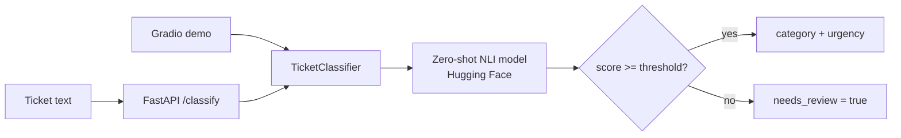

# AI Ticket Triage

> Classify support tickets by **category** and **urgency** with an open-source multilingual **Hugging Face** model — no training data required.


## Why this project

Support and operations teams lose time reading every incoming ticket just to decide where it goes and how urgent it is. This service does that first triage automatically — in English, Spanish, Catalan and many other languages — so people can focus on solving the problem instead of sorting it.

It uses **zero-shot classification** with a Natural Language Inference model: categories are plain-language descriptions in `labels.yaml`, so they can be changed without retraining anything.

## Features (v0.1)

- **Zero-shot, multilingual classification** with [`MoritzLaurer/mDeBERTa-v3-base-mnli-xnli`](https://huggingface.co/MoritzLaurer/mDeBERTa-v3-base-mnli-xnli) (configurable via `TRIAGE_MODEL`)
- **Configurable labels**: categories, urgency levels, review threshold and hypothesis template in `labels.yaml`, validated on load
- **Confidence scores** and a **`needs_review`** flag when the model is not sure
- **REST API** with FastAPI: `POST /classify`, `POST /classify/batch` (up to 50), `GET /labels`, `GET /health`, OpenAPI docs at `/docs`
- **Lazy model loading**: the API starts instantly and loads the model on the first request
- **Gradio demo** with multilingual examples, ready for Hugging Face Spaces
- **Evaluation**: accuracy, per-class precision/recall and confusion matrix on a labelled dataset (30 synthetic tickets in EN/ES/CA), runnable locally or with one click in GitHub Actions
- **Tested without the model**: 31 tests use a deterministic fake pipeline, so CI is fast and needs no GPU or model download
- **Docker image** with CPU-only PyTorch and optional model preloading

## Architecture



## Example

```bash
curl -X POST http://localhost:8000/classify \
  -H "Content-Type: application/json" \
  -d '{"text": "No puedo iniciar sesión desde que cambié la contraseña"}'
```

Response format:

```json
{
  "category": "access",
  "category_score": 0.0,
  "urgency": "medium",
  "urgency_score": 0.0,
  "needs_review": false
}
```

Scores depend on the model and on `labels.yaml`; run the evaluation to see real numbers.

## Getting started

```bash
git clone https://github.com/xavieroldan/ai-ticket-triage.git
cd ai-ticket-triage
python -m venv .venv && source .venv/bin/activate     # Windows: .venv\Scripts\activate
pip install torch --index-url https://download.pytorch.org/whl/cpu
pip install -r requirements-model.txt
uvicorn app.api:app --reload
```

Open http://localhost:8000/docs. The first request downloads the model (~1 GB) into the Hugging Face cache.

With Docker:

```bash
docker build -t ai-ticket-triage .
docker run -p 8000:8000 ai-ticket-triage
```

Demo:

```bash
pip install -r requirements-demo.txt
python -m demo.gradio_app
```

## Evaluation

```bash
python -m eval.evaluate                 # uses eval/dataset.csv
python -m eval.evaluate my_tickets.csv  # CSV with text,category,urgency
```

Or run the **Evaluate model** workflow from the *Actions* tab: it downloads the model and publishes the report in the run summary.

## Development

```bash
pip install -r requirements-dev.txt   # light: no torch, no model
ruff check .
pytest -q
```

## Repository structure

```text
.
├── app/
│   ├── config.py        # labels.yaml loading and validation
│   ├── classifier.py    # Zero-shot classification logic
│   ├── api.py           # FastAPI endpoints
│   └── metrics.py       # Accuracy, precision/recall, confusion matrix
├── demo/gradio_app.py   # Hugging Face Spaces demo
├── eval/
│   ├── dataset.csv      # 30 synthetic labelled tickets (EN/ES/CA)
│   └── evaluate.py      # Evaluation report
├── tests/               # pytest with a fake pipeline
├── labels.yaml
├── Dockerfile
└── .github/workflows/   # ci.yml (lint + tests), evaluate.yml (manual)
```

## Tech stack

Python 3.11 · Hugging Face Transformers · PyTorch · FastAPI · Pydantic · Gradio · pytest · Ruff · Docker · GitHub Actions

## Roadmap

- [x] Configurable labels with validation
- [x] Zero-shot classifier with review flag
- [x] REST API with batch endpoint
- [x] Gradio demo
- [x] Evaluation script and synthetic dataset
- [x] Docker image and CI
- [ ] Publish the demo on Hugging Face Spaces
- [ ] Publish baseline evaluation results in this README
- [ ] Larger, more realistic evaluation dataset
- [ ] Optional LLM fallback for low-confidence tickets

## What this project demonstrates

- Applying **open-source AI models** to a real business problem
- A clean, tested **REST API** around a model, with the model isolated behind an interface
- **Measuring** model quality instead of assuming it works

## Author

**Xavier Roldán** — Senior Developer & Team Lead
[xavierroldan.com](https://xavierroldan.com) · [LinkedIn](https://www.linkedin.com/in/xavierroldan/)

## License

MIT
